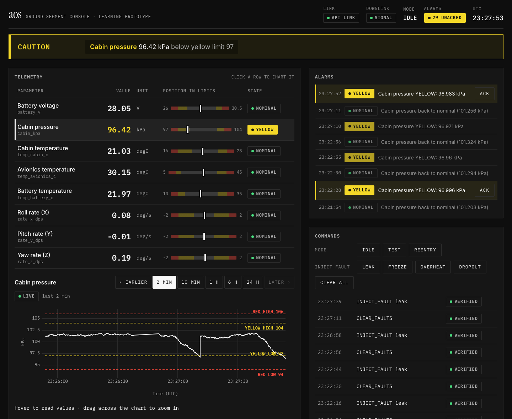
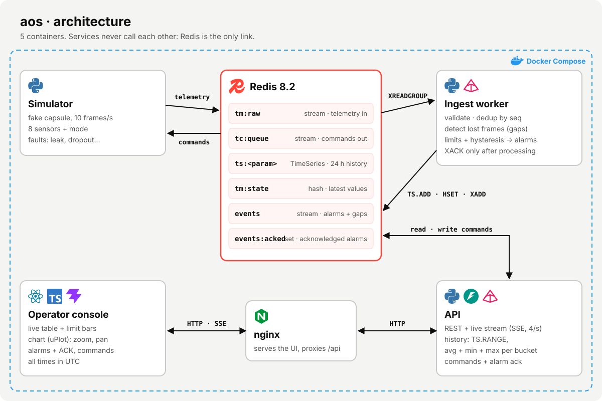
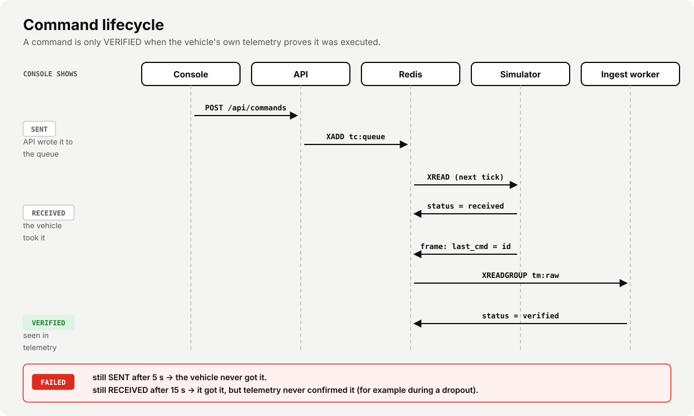
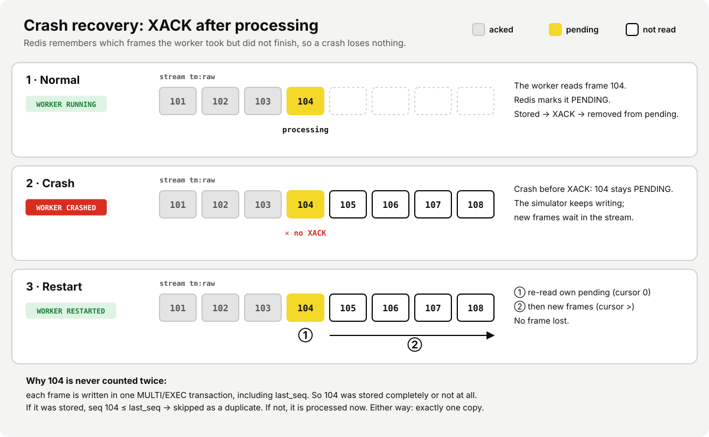
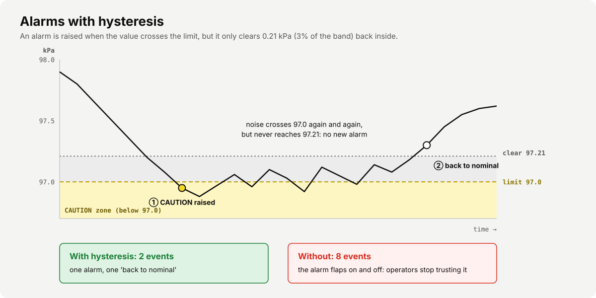

# aos

*AOS (acquisition of signal): the moment the ground hears the spacecraft again.*

A small mission-control console. A simulated vehicle sends telemetry at 10 Hz. An ingest worker
validates it, detects lost frames, checks limits and stores history. A live React console shows
everything to a flight controller, who can acknowledge alarms and send commands (including fault injection).

This is a learning prototype I built to explore Redis Streams, Redis TimeSeries and live operator UIs.
Telemetry packets are simple JSON, not a real spacecraft protocol (no CCSDS).


*During a cabin leak: the banner says what is wrong, the row turns yellow, the chart shows the drop,
an alarm waits for ACK, and the leak command is VERIFIED.*

## Architecture



### Data flow

1. **Simulator** builds one frame every 100 ms (`seq`, time, 8 parameters, mode, `last_cmd`) and
   appends it to the stream `tm:raw` (capped at about 50,000 entries).
2. **Ingest worker** reads `tm:raw` through the consumer group `ingest`. For each frame it:
   - validates the frame with Pydantic,
   - checks the sequence number: drops duplicates and raises a *gap* event when frames are missing,
   - stores each value with `TS.ADD` into `ts:<param>`,
   - compares each value with its yellow/red limits and writes an event **only when the level changes**,
   - updates `tm:state` (latest value, receive time, limit level),
   - marks a command *verified* when its id appears in `last_cmd`,
   - and only then calls `XACK`. On restart it first re-reads its own pending (un-acked) frames.
3. **API** pushes a snapshot of `tm:state` to the browser over SSE 4 times per second. It serves chart
   history with `TS.RANGE`, downsampled on the server to about one point per chart pixel (avg + min + max
   per bucket), plus the alarm log, alarm ack, and commands.
4. **Commands** go the other way: `POST /api/commands` → stream `tc:queue` → the simulator executes
   one per tick and echoes the command id in the next frame.

### Commands: sent → received → verified



### Crash recovery



### Alarms and hysteresis



### Design decisions

| Decision | Why |
| --- | --- |
| Redis Streams instead of Kafka | One small container. It has the same ideas as Kafka (append-only log, consumer groups, offsets, ack), so the design moves to Kafka when we need partitions, long retention or many consumers. |
| `XACK` after processing + dedup by `seq` | At-least-once delivery: a crash never loses a frame. Dedup makes a re-processed frame harmless (idempotent ingest). |
| Events on level change only + 3% hysteresis | One alarm per real problem. Noise near a limit cannot make an alarm flap on and off. |
| SSE instead of WebSocket | Live data goes one way (server → browser). Commands are normal `POST` requests. SSE is plain HTTP and reconnects automatically. |
| Command status `sent → received → verified` | "Sent" is not "done". A command is verified only when the vehicle's own telemetry confirms it. It is `failed` if not received in 5 s, or not verified in 15 s. |
| Downsample on the server, min/max band | The browser holds a few hundred points for any window (2 min or 24 h), so it stays fast. Min/max per bucket keeps a short spike visible: an average alone would hide it. |
| STALE / LOSS OF SIGNAL after 2 s | A frozen number looks like a good number. Old data must look old. |
| Monochrome UI, colour only for abnormal | High-performance HMI rule (ISA-101 style): when everything is calm the screen is grey, so yellow and red are seen at once. Status is always text + colour. All times are UTC. |

## Tech stack

| Layer | Technology | Used for |
| --- | --- | --- |
| Messaging + storage | **Redis 8.2** (Streams, TimeSeries, hash, set) | Telemetry and command queues, history, latest state, alarm log |
| Backend language | **Python 3.12**, **uv** (packages, lock file) | Simulator, ingest worker, API |
| API | **FastAPI**, **Uvicorn**, `redis.asyncio` | REST endpoints and the SSE live stream |
| Validation | **Pydantic v2** | Frame schema, command requests |
| Config | **PyYAML** (`limits.yaml`) | Parameter labels, units, yellow/red limits |
| Frontend | **React 19**, **TypeScript 5.8**, **Vite 6** | Operator console |
| Charts | **uPlot** | Fast live time-series chart with limit lines |
| Styling | Plain CSS with design tokens; Inter, IBM Plex Mono, Instrument Serif | Dark console theme, WCAG AA contrast |
| Web server | **nginx 1.27** | Serves the built UI, proxies `/api` (buffering off for SSE) |
| Tests | **pytest** (unit), **Playwright** (end-to-end), **ESLint** | See [Tests](#tests) |
| Run | **Docker Compose** | Whole stack with one command |

### What each part does

| Part | File | Notes |
| --- | --- | --- |
| Simulator | `backend/aos/simulator.py` | 8 parameters + mode at 10 Hz. Faults: leak, freeze, overheat, dropout. |
| Ingest worker | `backend/aos/ingest.py` | Consumer group, dedup, gap detection, limit checks, `TS.ADD`, alarm events. |
| Shared logic | `backend/aos/core.py`, `limits.yaml` | Redis key names, frame model, limit classification with hysteresis, sequence check. |
| API | `backend/aos/api.py` | `GET /api/live` (SSE), `/api/history`, `/api/events` + `/ack`, `/api/commands`, `/api/parameters`. |
| Console | `web/src` | Situation banner (one line: what is wrong now), telemetry table with position-in-limits bar, live chart (time windows 2 min to 24 h, drag to zoom, earlier/later, hover to read values, labelled limit lines), alarm log with ack, command panel. |

## Run

```bash
docker compose up -d --build
```

Open http://localhost:8090. Host ports: 8090 (console), 8001 (API), 6380 (Redis).

Try it: click **leak** (cabin pressure drops 0.4 kPa/s, goes yellow then red), **dropout**
(10 s of silence: the console shows LOSS OF SIGNAL and every row goes STALE, then the ingest worker
reports how many frames were lost), **overheat**, **freeze**, then **clear all**.

To see crash recovery: `docker compose stop ingest`, wait a few seconds, `docker compose start ingest`.
The worker re-reads its pending frames, catches up, and no frame is lost.

## Tests

```bash
cd backend && uv run pytest          # unit tests: limits, hysteresis, gap/duplicate detection, frame validation
cd web && npm run e2e                # Playwright against the running stack: leak -> yellow -> alarm -> ack
```

## Develop the UI without Docker

```bash
docker compose up -d redis simulator ingest api
cd web && npm install && npm run dev    # Vite on :5173, proxies /api to :8001
```

## Known limitations

- Restarting the simulator resets `seq` to 0. The worker still has the old `ingest:last_seq`, so it treats
  every new frame as a duplicate and the console freezes. Workaround: `docker compose exec redis redis-cli DEL ingest:last_seq`.
  Fix: treat a large backwards jump as a counter reset.
- One ingest consumer only. No authentication. JSON frames, not CCSDS packets.

## Next steps

- Replay mode: pick a time window and play it back from Redis TimeSeries.
- Show telemetry gaps as gaps in the chart (today the line is drawn straight across).
- Archive old stream data to object storage (MinIO / S3) as JSONL or Parquet.
- Several ingest consumers in the group, with a claim of stuck pending entries (`XAUTOCLAIM`).
- GitHub Actions running both test suites against `docker compose`.
